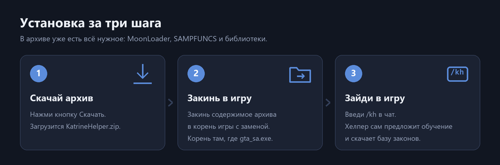

  

<h1 align="center"><a href="https://github.com/qqwekky/KatrineHelper">Katrine Helper AI</a></h1>

<a href="https://github.com/qqwekky/KatrineHelper"><strong>Хелпер для МВД на Advance RP Blue</strong></a>

Всем привет! Сделал хелпер для <a href="https://i.pinimg.com/736x/86/eb/00/86eb0019f400df25a94bcc7344f25723.jpg">МВД-шников</a>. Можно спросить ИИ по законам сервера, быстро проверить человека по чёрным спискам МВД и <a href="https://forum.adv-rp.com/threads/gov-chernyi-spisok-federatsii.2160577/">Федерации</a>, настроить свои бинды и поручить хелперу доклады по патрулю.
<h2>Спросить по законам</h2>
Открываешь <strong>/ask</strong> и описываешь ситуацию как есть. Например:
<blockquote>
Как правильно проводить трафик-стоп 10-55? Как провести допрос? Какие статьи нарушил гражданский в этой ситуации?
</blockquote>
ИИ ищет нужные статьи в базе сервера и объясняет простыми словами, как они связаны с твоей ситуацией. В базе есть УК, АК, ПК, Устав МВД, федеральные законы, регламенты, программа Академии и пособие по КТО. Статьи из ответа можно открыть прямо в меню и прочитать целиком.

ИИ отвечает на основе базы законов и правил с форума Advance RP и использует только информацию из неё. Скачанную базу можно открыть через <strong>/laws</strong>. В ней больше полутора тысяч статей. Есть поиск по номеру, словам или точной фразе, а нужные статьи можно добавить в избранное.

  
   <em>Вопросы ИИ по законам сервера.</em>

  
   <em>Поиск по законам и документы в базе.</em>

<h2>Что ещё есть в хелпере</h2><ul>
<li><strong>Отыгровки.</strong> Вводишь команду, она сразу уходит на сервер, а строки /me и /do идут следом по очереди. Можно ввести /cuff, /hold и /putpl, пока отыгровки ещё идут, и каждая команда сработает сразу. Команды срабатывают быстрее чем в МВД хелпере из-за того при аресте удобнее. Тексты можно переписать под себя в биндере.</li>
<li><strong>Патруль.</strong> Когда выезжаешь из участка на служебной машине, хелпер предлагает начать патруль. Подтверждаешь, и он отправляет доклады в рацию с заданным интервалом. Можно включить скрины после докладов с /c 60.</li>
<li><strong>Чёрные списки.</strong> Вводишь <strong>/bl ID</strong>, и хелпер проверяет игрока по ЧС МВД и общим спискам организаций. Ищет по номеру аккаунта и нику, учитывает замену похожих символов вроде I, l. Причину, степень и дату записи видишь только ты. Если включил отыгровку проверки, в чат пойдёт короткий ответ диспетчера.</li>
<li><strong>Снаряжение.</strong> AutoWeapon берёт на складе выбранное оружие и броню. AutoBuy докупает в 24/7 аптечки, маски и ремкомплекты до количества, которое ты указал.</li>
<li><strong>Бинды и колесо команд.</strong> Можно повесить свои команды на клавиши или добавить их в радиальное меню. Зажимаешь колесо мыши, наводишься на нужный пункт и отпускаешь.</li>
<li><strong>По мелочи.</strong> Теги рации, фильтр чата, ответ на звонок с клавиш и перенос длинных сообщений. Всё это включается по отдельности.</li>
</ul><h2>Как выглядит меню</h2>

<strong>Офицер, патруль, снаряжение и ЧС</strong>

  
   <em>Профиль офицера и предпросмотр отыгровок.</em>

  
   <em>Патруль, интервалы и тексты докладов.</em>

  
   <em>Снаряжение со склада и покупки в 24/7.</em>

  
   <em>Чёрные списки и ответ диспетчера.</em>

<strong>Биндер, колесо команд и служебные функции</strong>

  
   <em>Биндер и редактирование отыгровок.</em>

  
   <em>Радиальное меню и свои команды.</em>

  
   <em>Служебные функции и теги рации.</em>

  
   <em>Заметки прямо в меню хелпера.</em>

<strong>Настройки и меню в игре</strong>

  
   <em>Пауза между строками, перенос текста и клавиши.</em>

  
   <em>Меню и инфо-виджет поверх игры.</em>

<strong>Фоны и оформление</strong>

  
   <em>Фон ДОТА.</em>

  
   <em>Настройки оформления. Фон ШАДОУФИНД.</em>

  
   <em>Фон ВОРЛД ОФ ТЭНКС.</em>

  
   <em>Фон Альтушка 2д.</em>

  
   <em>Фон Альтушка риал лайф.</em>

<h2>Установка</h2>

<strong>Закинь содержимое архива в корень игры с заменой.</strong> Корень игры это папка, где лежит gta_sa.exe. Потом зайди в игру и введи <strong>/kh</strong>.

Основные компоненты: MoonLoader v.027.0 preview3 SAMPFUNCS v5.7.1 для SA-MP 0.3.7 R1

Библиотеки: mimgui, samp.events, encoding, vkeys, luasocket, luasec

Если хелпер у тебя уже стоит, ничего качать не надо, он обновляется сам.

<h2>Команды</h2><ul>
<li><strong>/kh</strong> Открывает меню.</li>
<li><strong>/ask</strong> Задаёт вопрос ИИ. Вопрос можно написать сразу после команды.</li>
<li><strong>/laws</strong> Открывает поиск по законам. Можно сразу указать номер статьи или текст.</li>
<li><strong>/bl ID</strong> Проверяет игрока по чёрным спискам.</li>
<li><strong>/patrol</strong> Позволяет вручную начать или закончить патруль.</li>
<li><strong>/sus ID</strong> Помогает оформить розыск со статьёй из базы.</li>
<li><strong>/cuff, /search, /ticket</strong> Запускают нужное действие с отыгровкой.</li>
<li><strong>/stoprp</strong> Останавливает отыгровку и чистит очередь.</li>
</ul>
Остальные команды и их тексты лежат в разделе <strong>Биндер</strong>.

<h2>Что уходит в сеть</h2><ul>
<li>Когда задаёшь вопрос ИИ, бесплатный сервис получает текст вопроса и найденные статьи. Игровой чат и ники окружающих игроков хелпер сам не добавляет. ИИ можно выключить в настройках.</li>
<li>База законов и чёрные списки скачиваются и хранятся у тебя на компьютере.</li>
</ul>
<strong>Автор <a href="https://github.com/qqwekky">qqwekky</a></strong>

<strong>Скрипт буду обновлять и дорабатывать. Если заметил баг или есть идеи, что улучшить, буду благодарен за фидбек.</strong>

Нашёл баг? Кидай в тему на форуме или напиши в Discord qqwekky, посмотрю.

